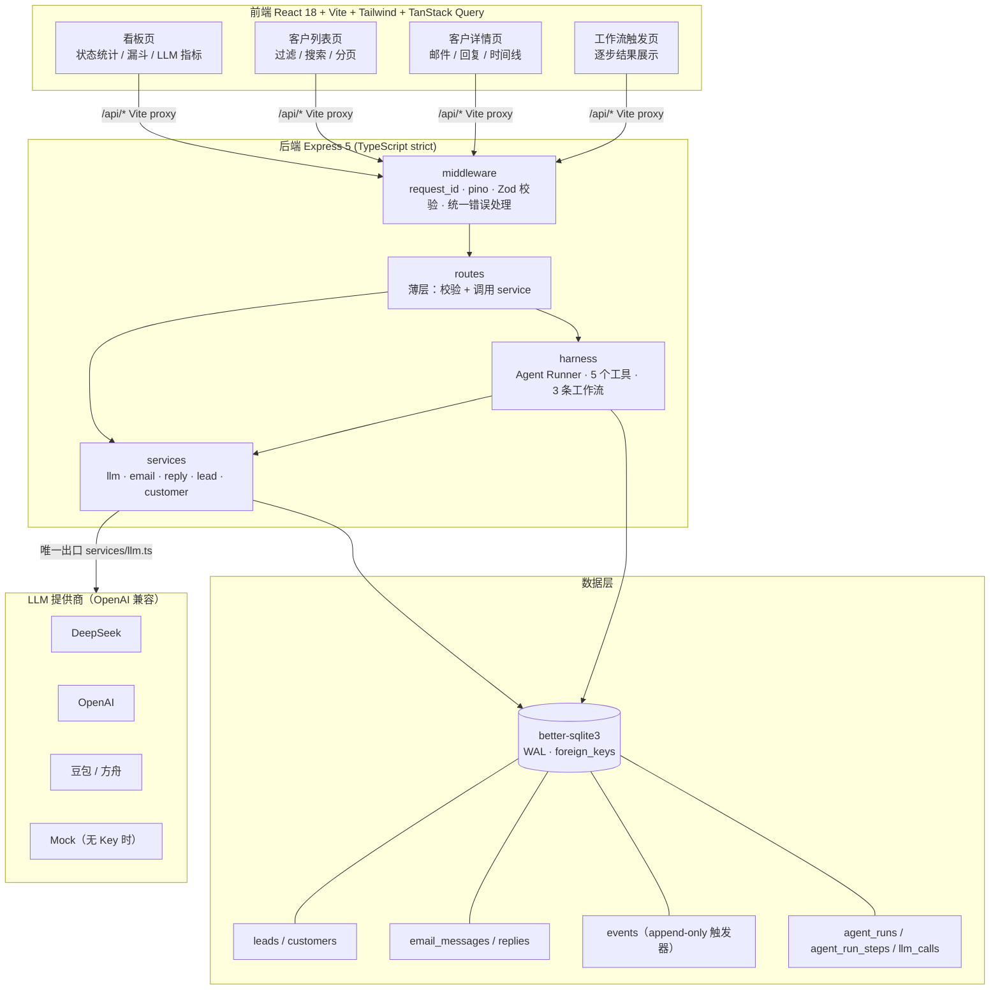
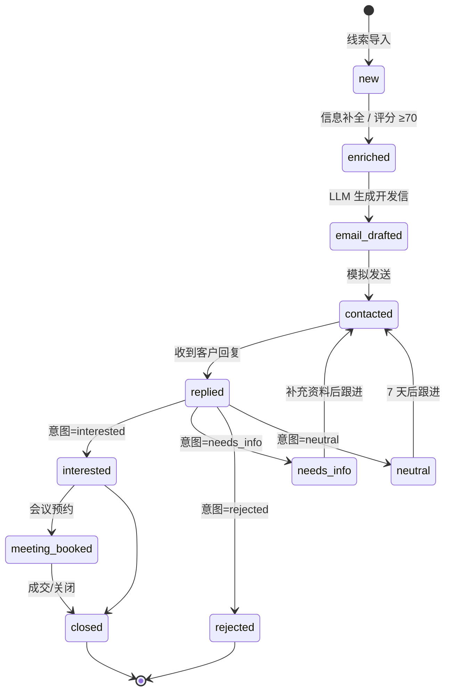
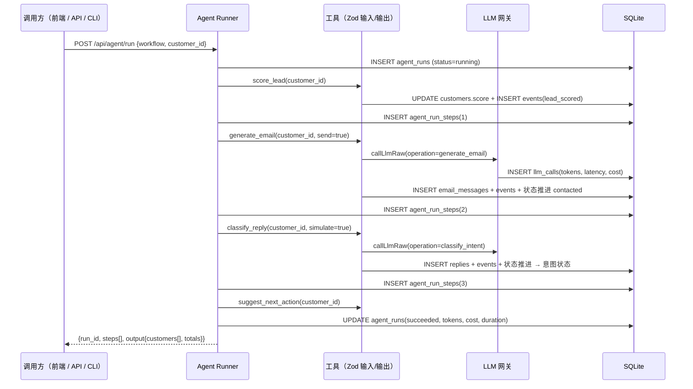

# B2B Sales Agent —— 端到端销售自动化 Agent

[](https://github.com/regulus9787/b2b-sales-agent/actions/workflows/ci.yml)
[](LICENSE)
[](#7-测试与评估)
[](#7-测试与评估)
[](tsconfig.json)
[](package.json)

> 线索导入 → LLM 生成个性化开发信 → 客户状态管理 → 模拟客户回复 → LLM 意图分类 → 自动更新状态 → React 看板可视化

一个**可运行、可演示、可测试**的完整项目：TypeScript strict + Express 5 + better-sqlite3 + Zod + pino + Vitest/Supertest + Swagger 后端，React 18 + Vite + Tailwind + TanStack Query 前端，Docker 一键部署。

**零密钥可跑通全流程**：`LLM_API_KEY` 为空时自动进入 Mock 模式（确定性邮件生成 + 规则意图分类器，分类准确率 92.31% / 26 条标注样本）。

**CI 全程零成本**：GitHub Actions 在 Mock 模式下跑完类型检查、Lint、152 个测试、覆盖率与意图评估，不消耗任何 LLM 额度。

---

## 1. 核心能力

| 能力 | 说明 |
|---|---|
| 线索导入与去重 | 按 `email + company_name` 归一化哈希去重，规则评分 0-100（行业/规模/地区/联系方式/需求信号） |
| 个性化开发信 | 版本化 Prompt（v1.2.0）→ LLM 网关 → 落库 `email_messages`，状态推进到 `email_drafted` / `contacted` |
| 客户状态机 | 11 个状态、显式合法跳转表，非法跳转 HTTP 409 + `INVALID_STATUS_TRANSITION` |
| 事件溯源 | 每次状态变更写 `events` 表；SQLite 触发器保证 append-only（UPDATE/DELETE 直接被拒） |
| 意图分类 | 严格 JSON + Zod enum 校验（`interested` / `needs_info` / `rejected` / `neutral`），失败降级为 `neutral` 并记录 |
| LLM 网关 | AbortController 超时（默认 30s）、指数退避重试（429/5xx/网络错误）、Retry-After 解析、token 与成本统计、`llm_calls` 全量落库 |
| Agent Runner | 5 个工具（输入/输出 Zod schema）+ 3 条工作流，每步输入/输出写入 `agent_run_steps` |
| 可观测性 | pino JSON 日志（method/path/status/duration_ms/request_id）、LLM 调用明细、状态变更审计、request_id 全链路 |
| 前端看板 | 4 个页面：看板统计、客户列表（过滤/搜索/分页）、客户详情（邮件/回复/时间线/LLM 明细）、工作流一键触发 |

---

## 2. 架构

### 2.1 系统架构



### 2.2 客户状态机



> 非法跳转（如 `new → closed`）返回 HTTP 409 + 错误码 `INVALID_STATUS_TRANSITION`，且**不写入任何事件**。
> 自环（如 `contacted → contacted`）视为幂等，仅追加事件。

### 2.3 Agent 工作流



### 2.4 数据模型

```mermaid
erDiagram
    LEADS ||--o| CUSTOMERS : "导入后关联"
    CUSTOMERS ||--o{ EMAIL_MESSAGES : "开发信"
    CUSTOMERS ||--o{ REPLIES : "客户回复"
    CUSTOMERS ||--o{ EVENTS : "append-only 审计"
    CUSTOMERS ||--o{ AGENT_RUNS : "触发"
    AGENT_RUNS ||--o{ AGENT_RUN_STEPS : "每一步"
    AGENT_RUNS ||--o{ LLM_CALLS : "run_id 关联"

    LEADS {
        int id PK
        text company_name
        text email
        text dedupe_hash UK
        int score
        int customer_id FK
    }
    CUSTOMERS {
        int id PK
        text company_name
        text email UK
        text status "11 状态枚举"
        int score
        text last_contacted_at
        text last_replied_at
    }
    EMAIL_MESSAGES {
        int id PK
        int customer_id FK
        text subject
        text body
        text status "draft|sent|failed"
        text model
        int prompt_tokens
        int completion_tokens
        int latency_ms
    }
    REPLIES {
        int id PK
        int customer_id FK
        text body
        text intent "4 类意图"
        real confidence
        int needs_human
    }
    EVENTS {
        int id PK
        int customer_id FK
        text event_type
        text from_status
        text to_status
        text trigger
        text run_id
    }
    AGENT_RUNS {
        text run_id UK
        text workflow
        text status
        int steps_count
        int total_tokens
        real total_cost_usd
        int duration_ms
    }
    AGENT_RUN_STEPS {
        int id PK
        text run_id
        int step_index
        text tool
        text input
        text output
    }
    LLM_CALLS {
        int id PK
        text run_id
        text provider
        text model
        text operation
        int prompt_tokens
        int completion_tokens
        int latency_ms
        real cost_usd
        text status
    }
```



---

## 3. 快速开始

### 3.1 环境要求

- Node.js >= 20（推荐 22 LTS；已在 Node 24.21.0 上验证，需搭配 `better-sqlite3` ^13，见 FAQ 5.4）
- npm >= 10
- 可选：Docker + Docker Compose

### 3.2 安装依赖

```bash
# 后端依赖
npm install

# 前端依赖
npm install --prefix frontend
```

### 3.3 初始化数据库（建表 + 10 条模拟客户）

```bash
npm run init-db
```

输出示例：

```
[init-db] 数据库路径: C:\DH-test\sales-agent.db
[init-db] schema 版本: 2 / 目标 2
[init-db] 表清单(9): agent_run_steps, agent_runs, customers, email_messages, events, leads, llm_calls, replies, schema_migrations
[seed] 插入 10 条客户，跳过 0 条已存在客户
[init-db] 完成 ✓  新增客户 10 条（跳过 0），当前 leads=10 customers=10 events=10
```

### 3.4 启动后端

```bash
# 方式一：一键复制环境变量（推荐，默认 Mock 模式）
cp .env.example .env        # Windows: copy .env.example .env
npm run dev
```

后端启动后：

- API 根路径：http://localhost:3000
- 健康检查：http://localhost:3000/health
- Swagger UI：http://localhost:3000/docs
- OpenAPI JSON：http://localhost:3000/docs/openapi.json

### 3.5 启动前端

```bash
npm run dev --prefix frontend
```

打开 http://localhost:5173

### 3.6 一条命令跑通演示（可选，不启动 HTTP 服务）

```bash
# 对客户 #1 跑完整工作流：评分 → 生成开发信 → 模拟回复 → 意图分类 → 状态推进
npm run agent:run -- --customer 1 --intent interested
```

### 3.7 Docker 一键部署

```bash
docker compose up --build
```

- 前端：http://localhost:5173（nginx 反代 `/api` 到后端容器）
- 后端：http://localhost:3000
- Swagger：http://localhost:3000/docs

后端容器启动时会自动执行迁移与 seed（幂等），数据库持久化在命名卷 `sales-agent-data`。

镜像设计：

- 后端 `Dockerfile`：多阶段构建（builder 编译 TS → runtime 只带 `dist` 与已编译的 `node_modules`，避免运行阶段重编译 better-sqlite3）；
- 前端 `frontend/Dockerfile`：`vite build` → nginx 托管静态资源 + `proxy_pass` 反代 `/api` 与 `/health`；
- `docker-compose.yml` 中前端 `depends_on: backend: condition: service_healthy`，后端 healthcheck 用 `node -e "fetch(...)"` 探测 `/health`。

> 说明：本仓库的 `docker-compose.yml` 已通过 YAML 结构校验（services/ports/volumes/healthcheck 均解析正常），
> 但当前开发环境未安装 Docker，因此**未在本机执行过 `docker compose up`**。请在装有 Docker 的机器上首次运行时留意构建日志；
> 若遇到问题，参考 [docs/FAQ.md](docs/FAQ.md) 第 8 节「Docker 相关」。

---

## 4. 环境变量

复制 `.env.example` 为 `.env`：

| 变量 | 默认值 | 说明 |
|---|---|---|
| `PORT` | `3000` | 后端 HTTP 端口 |
| `NODE_ENV` | `development` | `development` / `test` / `production` |
| `LLM_API_KEY` | 空 | **留空即 Mock 模式**（零密钥可跑通全流程） |
| `LLM_BASE_URL` | `https://api.deepseek.com` | OpenAI 兼容接口地址 |
| `LLM_MODEL` | `deepseek-flash` | 模型名（用于成本估算与日志） |
| `LLM_TIMEOUT_MS` | `60000` | 单次调用超时（AbortController） |
| `LLM_MAX_RETRIES` | `3` | 最大重试次数（仅 429/5xx/网络错误） |
| `LLM_PROVIDER` | `deepseek` | `deepseek` / `openai` / `doubao` / `custom` / `mock` |
| `LLM_THINKING` | `disabled` | 思考模式：`disabled` / `enabled` / `minimal` / `low` / `high` / `max` |
| `DATABASE_PATH` | `./sales-agent.db` | SQLite 文件路径 |
| `LOG_LEVEL` | `info` | pino 日志级别（`silent` 可关闭） |
| `FRONTEND_PORT` | `5173` | 前端端口（仅用于启动提示） |
| `VITE_API_BASE_URL` | 空 | 前端 API 前缀；留空走 Vite proxy |

> **模型名注意**：DeepSeek 旧模型名 `deepseek-chat` / `deepseek-reasoner` 已于 2026-07-24 停用，
> 当前在售为 `deepseek-flash`（V4.1-Flash，便宜快）与 `deepseek-v4-pro`（能力强，约 4 倍价）。
> 价格见 [pricing](https://api-docs.deepseek.com/quick_start/pricing) 与 `src/services/pricing.ts`。
>
> **思考模式**：DeepSeek 的 `thinking` 默认是开启的，会先输出思维链（`reasoning_content`）再给正文。
> 本项目只读取 `content`，且意图分类要求严格 JSON，因此默认 `LLM_THINKING=disabled`：
> 既省输出 token（思维链按输出计费），也避免思维链干扰 JSON 抽取。想开启改为 `enabled`；
> 对 OpenAI / 豆包等不支持该参数的提供商，`disabled` 时不会发送该字段。

### 切换 LLM 提供商（示例）

```bash
# DeepSeek（当前在售模型）
LLM_API_KEY=sk-xxxx
LLM_BASE_URL=https://api.deepseek.com
LLM_MODEL=deepseek-flash
LLM_PROVIDER=deepseek
LLM_THINKING=disabled

# OpenAI
LLM_API_KEY=sk-xxxx
LLM_BASE_URL=https://api.openai.com/v1
LLM_MODEL=gpt-4o-mini
LLM_PROVIDER=openai

# 豆包 / 火山方舟
LLM_API_KEY=xxxx
LLM_BASE_URL=https://ark.cn-beijing.volces.com/api/v3
LLM_MODEL=doubao-pro-32k
LLM_PROVIDER=doubao
```

---

## 5. API 一览

所有响应统一信封：成功 `{ success: true, data, meta: { request_id } }`，失败 `{ success: false, error: { code, message }, meta }`。

| 方法 | 路径 | 说明 |
|---|---|---|
| GET | `/health` | 健康检查（含 schema 版本、LLM 模式、已注册工具） |
| GET | `/api/customers` | 客户列表：分页 / 状态过滤 / 搜索 / 排序 |
| GET | `/api/customers/status-machine` | 状态机定义（状态、合法跳转、终态、中文标签） |
| GET | `/api/customers/:id` | 客户详情：邮件 + 回复 + 状态时间线 + LLM 调用 + 下一步建议 |
| GET | `/api/leads` | 线索列表（分页 / 搜索） |
| POST | `/api/leads/import` | 批量导入线索（去重 + 评分，可同时触发工作流） |
| POST | `/api/email/generate/:customerId` | 生成个性化开发信（可模拟发送） |
| GET | `/api/email/customer/:customerId` | 某客户的邮件记录 |
| POST | `/api/reply/analyze/:customerId` | 分析回复 + 意图分类 + 自动更新状态 |
| GET | `/api/reply/customer/:customerId` | 某客户的回复与分类结果 |
| POST | `/api/agent/run` | 触发 Agent 工作流（3 种） |
| GET | `/api/agent/tools` | 已注册工具与工作流清单 |
| GET | `/api/agent/runs` | Agent 执行记录（分页） |
| GET | `/api/agent/runs/:runId` | 执行详情：每步输入/输出 + LLM 调用 + 事件 |
| GET | `/api/dashboard/stats` | 看板统计 |

完整字段与示例见 [docs/API.md](docs/API.md) 与 Swagger UI（http://localhost:3000/docs）。

### 错误码

| 错误码 | HTTP | 说明 |
|---|---|---|
| `VALIDATION_ERROR` | 400 | Zod 校验失败（带字段级 details） |
| `CUSTOMER_NOT_FOUND` | 404 | 客户不存在 |
| `LEAD_NOT_FOUND` | 404 | 线索不存在 |
| `AGENT_RUN_NOT_FOUND` | 404 | Agent 执行记录不存在 |
| `NOT_FOUND` | 404 | 接口不存在 |
| `INVALID_STATUS_TRANSITION` | 409 | 非法状态跳转 |
| `LLM_TIMEOUT` | 504 | LLM 调用超时 |
| `LLM_RATE_LIMIT` | 429 | 触发限流（读取 Retry-After） |
| `LLM_INVALID_OUTPUT` | 502 | LLM 输出未通过 Zod 校验 |
| `LLM_ERROR` | 502 | LLM 其他错误（含网络错误） |
| `INTERNAL_ERROR` | 500 | 未预期错误 |

### curl 示例

```bash
# 健康检查
curl http://localhost:3000/health

# 导入线索
curl -X POST http://localhost:3000/api/leads/import \
  -H "Content-Type: application/json" \
  -d '{"leads":[{"company_name":"Beijing Quantum Robotics","contact_name":"Liu Yang","email":"liu.yang@quantum-robotics.example.com","industry":"工业机器人","country":"CN","company_size":"100-500","notes":"展会收集，明确采购需求"}]}'

# 生成开发信并模拟发送
curl -X POST http://localhost:3000/api/email/generate/1 \
  -H "Content-Type: application/json" -d '{"send":true}'

# 模拟客户回复并做意图分类
curl -X POST http://localhost:3000/api/reply/analyze/1 \
  -H "Content-Type: application/json" -d '{"simulate":true,"intent":"interested"}'

# 跑完整工作流
curl -X POST http://localhost:3000/api/agent/run \
  -H "Content-Type: application/json" \
  -d '{"workflow":"full_cycle","customer_id":1,"simulate_intent":"interested"}'

# 看板统计
curl http://localhost:3000/api/dashboard/stats
```

---

## 6. npm 脚本

| 命令 | 说明 |
|---|---|
| `npm run dev` | 启动后端（tsx watch） |
| `npm run build` | 编译到 `dist/` |
| `npm start` | 运行编译产物 |
| `npm run typecheck` | `tsc --noEmit` 全量类型检查 |
| `npm run init-db` | 建表 + seed（幂等） |
| `npm run seed` | 仅 seed |
| `npm run reset-db` | 删除数据库文件后重建（危险，仅开发） |
| `npm run agent:run -- --customer 1 --intent interested` | CLI 跑工作流 |
| `npm run eval:intent` | 意图分类评估（26 条标注样本，输出准确率） |
| `npx tsx scripts/compare-llm-modes.ts 1` | 同客户 Mock vs 真实模型横向对比 |
| `npm test` | 运行 152 个测试 |
| `npm run test:coverage` | 覆盖率报告（阈值：核心 service ≥80%） |
| `npm run openapi` | 导出 `docs/openapi.json` |
| `npm run lint` | ESLint |
| `npm run format` | Prettier |

---

## 7. 测试与评估

```bash
npm test              # 152 个测试全部通过
npm run test:coverage # 覆盖率报告（文本 + HTML + lcov）
npm run eval:intent   # 意图分类准确率（26 条标注样本）
```

真实模型 vs Mock 的**实测对比**（邮件质量、分类置信度、耗时、成本换算）见
[docs/LLM-COMPARISON.md](docs/LLM-COMPARISON.md)；一键复现：

```bash
npx tsx scripts/compare-llm-modes.ts 1   # 同客户双模式横向对比
```

覆盖率实测（核心 service ≥ 80% 达标）：

```
All files       | % Stmts 94.76 | % Branch 78.48 | % Funcs 91.53 | % Lines 94.76
 core           |        97.50 |         91.80 |        96.42 |        97.50
 services       |        94.86 |         80.54 |        90.14 |        94.86
 harness        |        94.29 |         67.16 |       100.00 |        94.29
 db             |        88.34 |         69.56 |        70.00 |        88.34
```

`npm run eval:intent` 输出（Mock 规则分类器）：

```
总准确率  : 92.31%  (24/26)
分类别准确率：
  - interested   85.71%  (6/7)
  - needs_info   85.71%  (6/7)
  - rejected    100.00%  (6/6)
  - neutral     100.00%  (6/6)
PASS：准确率阈值 80%（可用 EVAL_MIN_ACCURACY 调整）
```

> 配置真实 `LLM_API_KEY` 后，同一命令会用真实模型评估，准确率通常高于规则分类器。
> 覆盖率报告位置：`coverage/index.html`（HTML）、`coverage/lcov.info`（CI 集成）。

详见 [docs/FAQ.md](docs/FAQ.md) 的「测试与评估」章节。

---

## 8. 目录结构

```
.
├── AGENTS.md                 # Harness 规范（本项目的开发契约）
├── README.md
├── LICENSE                   # MIT
├── VERIFICATION.md           # 实测验证记录与修复复盘
├── package.json              # 后端（CommonJS）
├── tsconfig.json             # strict + noUncheckedIndexedAccess
├── vitest.config.ts          # forks 池 + 强制 Mock 模式（tests/setup.ts）
├── eslint.config.mjs / .prettierrc.json
├── .gitattributes            # 统一换行符策略
├── Dockerfile                # 后端多阶段镜像
├── docker-compose.yml        # 后端 + 前端
├── .env.example
├── .github/workflows/ci.yml  # CI：类型检查 / Lint / 测试 / 覆盖率 / 评估 / 构建
├── src
│   ├── index.ts              # 入口：迁移预热 + 优雅退出
│   ├── app.ts                # Express 5 装配（中间件顺序即安全边界）
│   ├── config.ts             # 环境变量 Zod 校验 + Mock 模式判定
│   ├── core                  # 领域层：状态机 / 事件 / 错误码 / 模型
│   ├── db                    # db.ts / migrations.ts / seed.ts / init-db.ts
│   ├── services              # llm / prompts / llm-mock / pricing / llm-log / lead / email / reply / customer
│   ├── harness               # runner / tools / workflow / run-cli
│   ├── routes                # 7 个薄路由文件 + 汇总
│   ├── schemas               # Zod 入参/出参
│   ├── middleware            # requestId / logger / validate / response / errorHandler / asyncRoute
│   ├── docs                  # swagger-jsdoc 配置
│   └── types
├── frontend                  # React 18 + Vite + Tailwind + TanStack Query
│   └── src/{api,components,lib,pages}
├── docs                      # API.md / FAQ.md / LLM-COMPARISON.md / openapi.json
├── postman/collection.json
├── data/intent-eval.jsonl    # 26 条标注样本
├── scripts                   # eval-intent / export-openapi / compare-llm-modes / check-payload
└── tests
    ├── helpers/testDb.ts
    ├── unit/                 # status / events / llm / lead / email / reply / customer / agent
    └── integration/          # api / workflow
```

---

## 9. 设计要点

1. **状态机是唯一事实来源**：`src/core/status.ts` 的 `STATUS_TRANSITIONS` 同时驱动校验、错误信息、API 文档与前端下拉框，避免多处硬编码漂移。
2. **事件溯源 + 物理不可变**：`events` 表用 SQLite 触发器拦截 UPDATE/DELETE，应用层无法"悄悄改历史"；任何状态都能从事件链完整重建。
3. **LLM 网关收口**：全项目只有 `services/llm.ts` 发 HTTP；超时/重试/限流/校验/降级/计量六件事只实现一次，路由层零 `fetch`。
4. **降级而非崩溃**：LLM 失败 → 规则兜底 + `fallback: true` 标记 + `llm_calls.status='error'` 留证，业务链路继续推进。
5. **Mock 模式是第一等公民**：无密钥可演示、可 CI、可测试；`mock` 标记贯穿 `email_messages.mock`、`replies.mock`、`llm_calls.mock`，看板单独展示"其中 N 次为 Mock 调用"。
6. **工具协议化**：Agent 工具用 Zod 双 schema 约束输入/输出，Runner 统一校验 + 落库，新增工具零改动编排层。
7. **可测试性设计**：DB 单例可注入（`setDb`）、fetch 可注入（`fetchImpl`）、Mock 可覆盖（`mock`/`apiKey` 选项），因此超时/重试/限流都能在单测里确定性验证。
8. **CI 与本地一致且零成本**：`tests/setup.ts` 强制 Mock 模式，CI 跑完整质量门禁也不触发任何真实 LLM 调用；需要真实调用的场景一律用 per-call 覆盖显式声明。

---

## 10. 排障

常见问题（LLM 超时、429 限流、SQLite 锁、只读库 `SQLITE_READONLY`、端口占用、better-sqlite3 原生崩溃与版本要求、PowerShell 执行策略、`reset-db` 报 EPERM、Docker 启动）见 [docs/FAQ.md](docs/FAQ.md) 第 4、5、5.1–5.4 节。

已验证的运行证据（命令、输出、端到端链路追踪）见 [VERIFICATION.md](VERIFICATION.md)。

---

## 11. License

[MIT](LICENSE) © 2026 Jeremy Wang
